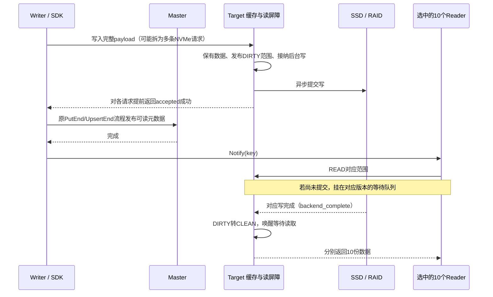

# Rank fan-out cache and gated early-write design

2026-11-25 design snapshot. Canonical long-term plan: `~/nof/docs/spdk/readcache-plan-2026-11-24.md`.

Current implementation: read caching and write-completion warming only. The early-ACK policy below is planned, not implemented or enabled.

## 2026-11-25 场景确认与新增写路径构想（当前有效约束）

本节依据用户补充、两项明确确认以及 Service / mp-yh / kvtest 源码。它描述已实现的读缓存与下一步拟开发的写策略，两者的完成状态必须分开记录。

### 真实业务单位：一次写入及其十路读取

1. rank 使用 `upsert_from` 写入、`get_buffer` 读取，`notify_count=10`、`kvtest.replica_num=1`、`base_qps=105`。这里“1 写 10 读”指同一个 key 的一次写入事件及其 fan-out，不代表集群只有一个 writer 进程。
2. 单个 writer 为该 key 写入一个 NoF 副本；该副本由 master 分配到某个 NoF segment 的地址范围。segment 由 target namespace/bdev 承载，可能是多 SSD RAID0，不能等同于单块物理 SSD。
3. writer pipeline 的 `Execute()` 成功后才调用 `Notify()`。当前实现从 reader peers 中随机选择十个不同接收者，发送同组 keys、size、sender。“通知所有 reader”按本次选中的十个 reader 理解，不是广播到整个集群的全部 reader 进程。
4. 十个 reader 获取该 key 的副本位置，读取同一副本对应的地址范围。这是 target 端复用数据的主要机会。**命中要求是同一有效版本的数据范围；仅仅访问同一个 NoF segment 不足以命中。**
5. 一个 8 MiB 对象可能被 NoF chunk / NVMe max_io / RAID boundary 拆成多个请求。一次冷读不等于一条 SSD 命令；减少重复读的目标应按每个对应范围统计，再汇总到完整对象。
6. recall 当前是 `notify_count=1`、双 NoF 副本，不能套用 rank 的十路重复读收益。不同 target/副本的缓存独立，不因两个副本保存相同 key 就共享缓存内存。

证据位置：`mp-yh_bare_nof_v2/configs/kvtest/nof/rank_official.json`、`recall_official.json`；Mooncake `benchmarks/kvtest/src/main.cpp` 中 `Execute -> Notify` 与 `Notify()`；`src/config.cpp` 的 reader peer 筛选；`master_service.cpp` 的 NOF_SSD allocation。原 workload JSON 不由本次计划修改。

### 三种数据路径要独立验收

| 模式 | writer 何时收到成功 | reader 的数据来源 | 状态 |
|---|---|---|---|
| R0：读时填充 | 底层写完成后 | 冷读从 SSD 填入 target 缓存；其余 reader hit 或合并等待同一冷读 | 已实现 |
| R1：写成功后预热 | 底层写完成后 | 已写数据在完成时进入 CLEAN 缓存，reader 可能从第一次就命中 | 已实现，populate-on-write |
| W2：易失性提前确认 + 读屏障 | target 完整接收、独立保有数据并成功接纳后台写后 | reader 可提前到达，但必须等待对应写达到提交条件，随后从 CLEAN 缓存或 SSD 返回 | 本次新增设计，尚未实现或开启 |

W2 仍需给 writer 发送一条前台成功的 NoF/NVMe completion，writer 才能继续 pipeline；变化是该 completion 代表 target 已接纳而非底层已完成。后台提交结果独立记录，不能稍后对已复用的同一 CID 再完成一次。

用户所说“SSD → target iobuf 缓存”在功能上对应 target 端数据复用。当前代码使用独立普通 host 数据缓存，命中后复制到请求 iobuf；普通 iobuf 的空闲 buffer 复用不是内容缓存。若写成功后仍保留数据，就不必强行让第一个 reader 再读 SSD：R1、W2 均可在提交后直接使用同一份已写内容。

### 用户已明确确认的 W2 实验语义

- **允许 reader 等待。** 要求是返回读数据之前，对应写已完成；不要求 reader 到达之前或 Notify 之前就完成。实现采用更容易验证的强约束：对应提交完成之前，不向 reader 发出数据传输。
- **实验允许丢失窗口。** writer 提前成功后，若 target 在后台写完成前崩溃，尚未提交的数据允许丢失，必须单独记录。不能把提前成功描述为已经持久化或具有抗故障承诺。
- 以上是用户已经给出的实验约束，不再将是否允许 reader 等待、是否接受该丢失窗口列为待确认问题。
- 当前软件仍按 R0/R1 的原写完成时点返回，W2 不因已有读缓存开关而自动生效。

### “写完成”与“持久化”的术语

- `accepted`：完整 H2C 数据已经到 target，拥有独立且有预算保障的副本，脏范围索引已发布，后台工作已进入有界队列。不是只收到 capsule，也不是仅调用了 `urma_post_*`。
- `backend_complete`：RAID/SSD bdev 回调成功，可作为普通读写时序的提交屏障。它不自动代表断电后一定保留。
- `media_durable`：满足相应 FUA / Flush 以及底层设备的持久化承诺。若设备有易失性写缓存，普通写完成与该条件必须区分。

本次 W2 的首个开发目标将“读前写完成”明确为 `backend_complete`，同时保持 FUA/Flush 本身的严格语义；若未来要求每次读之前都具备断电持久性，应选择独立的 durable read-gate 策略并计入额外耗时，不能只改名称。

依据：[SPDK bdev Flush 文档](https://spdk.io/doc/group__bdev__io__submit__functions.html)、[NVM Express Base Specification 2.1](https://nvmexpress.org/wp-content/uploads/NVM-Express-Base-Specification-Revision-2.1-2024.08.05-Ratified.pdf)。

### 时序：提前 Notify 时，等待发生在 target



该图展示 reader 比写完成更早到达的一种合法时序；若读到达时已经提交，则直接读 CLEAN 缓存。不能依赖 Notify 的网络耗时碰巧长于 SSD 写入耗时。当前源码会在写进行时让读走 backend bypass；这个行为在 R0/R1 中保持原有并发块 I/O 语义，但**W2 必须改为先检查脏范围并等待，不能沿用直通旧 SSD 数据的路径**。

时序不变量：

```text
payload_H2C_complete <= owned_buffer_ready <= dirty_range_published <= early_ACK
all_required_prior_writes_backend_complete <= reader_data_post <= reader_data_complete
```

第二条对每个重叠数据范围及其必需的写版本成立。对严格 durable 模式，屏障换成对应 FUA/Flush 达成，不能只等待普通写回调。

### 可行性结论及收益边界

W2 技术上可行，应作为显式 opt-in 的易失性写策略实现。它可以让 writer 更早释放前台等待、让通知/元数据处理与 SSD 写入重叠，并在提交后复用已写数据。它不能消除 SSD 的真实写带宽和延迟要求。

最早到达的 reader 仍可能等待剩余写延迟。因此应同时测 writer 的确认耗时、reader 的等待/返回耗时、writer 发起到所有指定 reader 完成的事件耗时；不能只看 writer 曲线变快。现有 R1 已经能够在保持原写确认时点的前提下减少后续 SSD 读取，必须作为 W2 的直接对照。

若唯一写入速率长期大于 SSD 排空速率，任何有限缓存都会耗尽。近似预算：

```text
dirty常驻均值 ≈ 每target唯一写入字节速率 × backend完成延迟
实际dirty预算 ≥ 均值 + 并发/突发/排队裕量
clean缓存预算 ≈ 每target唯一数据速率 × 十个reader的复用时间窗口
```

这里的写入速率按每次接纳的写版本计数，不按相同 LBA 去重；若同一范围保有多个在途版本，它们都消耗预算。

dirty 数据不能按普通 LRU 丢弃。达到配额/高水位必须在提前确认之前背压、转同步路径或拒绝接纳，并保证已有后台写继续排空。目标不是用不断增长的内存把过载隐藏起来。


### 阶段 4：易失性提前写确认 + 读屏障（新增，待开发）

本阶段按用户已确认的实验约束推进：允许 reader 等待；允许 ACK 后、后台提交前因 target 崩溃而丢失的数据窗口。它是新写策略，不是当前读缓存功能已经具备的行为。实施优先级是先验证 R0/R1，再实现/验证 W2，最后按测量决定是否需要阶段 5 的直接缓存发 URMA。

#### W0：固定接口和可观测的语义

拟议配置名称仅用于设计，不是当前已有环境变量或 RPC：

| 设计接口 | 初值/约束 | 含义 |
|---|---|---|
| `write_ack_policy` | `backend_complete` 为原行为 | 新增 opt-in 值 `volatile_early_ack_wait_read` |
| `read_commit_level` | W2 首个目标为 `backend_complete` | reader 返回前等待的提交条件；durable 为独立扩展 |
| `dirty_capacity_bytes` | 独立预算，实测后确定 | 不能从 CLEAN LRU 或请求 iobuf 中无上限借用 |
| `max_pending_writes/bytes` | 有界 | 确认前的接纳配额 |
| `dirty_high/low_watermark` | 有滞回的背压 | 避免在内存耗尽后仍不断成功确认 |
| `max_dirty_age` | 可观测、有限处置策略 | 排空滞后时背压并报告，不丢弃已确认数据 |

完成标准：配置能区分原写路径与 W2，日志/结果明确记录策略。不能以 `populate_on_write=1` 冒充提前确认。必须审计 bdev `write_cache`、NVMf `subsystem->vwc_present`、VWC feature 与 FUA/Flush 行为，不能只改一个标志位。当前 fork 对禁用 WCE 返回 Feature Not Changeable；任何新支持都必须真实排空并满足承诺，否则明确拒绝，不得返回虚假成功。

#### W1：独立所有权的后台写

新建与前台请求生命周期分离的后台操作，至少持有：namespace/segment 代次、操作序号、LBA 范围、不可变 payload、DMA 缓冲引用、后端状态、依赖和等待读列表、ACK/提交时间戳。

- 在 H2C 数据完成且状态成功后，校验完整长度，把数据转入独立、可用于 NVMe DMA 的 staging 所有权，并在确认前发布 DIRTY 范围及后台队列项。
- 原 NVMf request、bdev_io、CID、qpair 和 caller iobuf 可以在正常前台 completion 后复用；后台回调不得保存这些可能被释放/覆盖的指针，不得再次完成原写请求。
- 首个实现优先使用单独的 DMA staging 池，原 iobuf 在复制完成后按原 URMA 生命周期释放。不能把原 iobuf 放回空闲池后继续让 SSD DMA 读取它。
- 若改为长期 pin 原 iobuf，必须显式转移所有权、设置额度和 pool reserve，并证明不会耗尽正常读写与建链所需的 buffer；不能用“暂时不 free”代替所有权设计。
- 后台 staging 只用于 NVMe，初期不新增 URMA segment 注册。提交完成后可复制到当前 CLEAN 缓存并释放 staging；后续统一 DMA/CLEAN 池属于另一个成本优化点。
- 单独核算 dirty DMA 内存、CLEAN 普通内存、正常 iobuf 与元数据。DMA 池若来自 SPDK 大页，必须同步验证 target hugepages 配额，不能继续沿用“缓存只消耗普通内存”的旧结论。

完成标准：覆盖 ACK 后立即重用/覆盖客户端及 target 原 buffer、CID 重用、qpair 关闭的测试；后台写内容仍正确，原 completion 恰好一次。

#### W2：共享脏范围状态与读屏障

```text
接纳完整数据 → DIRTY_QUEUED → BACKEND_INFLIGHT → BACKEND_COMPLETE → CLEAN_READY
                       任意后台失败 → POISONED / RANGE_ERROR
```

- gate 在所有读取路径之前执行：CLEAN hit、cold miss、超限直通、特殊 flag、外部内存/其他绕过缓存的读均不能绕过重叠脏范围检查。
- 同范围的十个 reader 加入同一版本/范围的等待队列，共享一次提交条件；不能各自重复发起读盘，更不能直接读取尚未更新的 SSD 旧内容。
- 对一个跨多个脏范围的读，等待它需要的全部先行写。完成/唤醒在各自 SPDK thread 上执行，不阻塞 reactor、后台提交或 CQE 处理。
- 读在接纳时确定先行操作的序号屏障。后续不断到来的写不能让该读无限等待；不能把“当前没有任何在途写”作为唯一放行条件。
- 同一范围的重叠写按接纳顺序建立依赖或采用明确的版本调度，先行旧写不得在后续新写之后覆盖介质。不同地址范围仍应允许并行。
- 提交后的 owned payload 若仍在内存，可作为 CLEAN 数据使用，无需为了制造 cache miss 再从 SSD 读回。
- 块级 gate 不自动提供整个 8 MiB 对象的跨 chunk 原子快照。Notify 当前只携带 keys/size/sender，不携带精确内容版本；若实验要检验“此次通知对应版本”而非“读时最新版本”，需要 immutable key 或 SDK/元数据层的对象版本协议。

完成标准：所有依赖写完成时间不晚于该读的数据 post 时间；读到的版本满足约定。覆盖读先于提交、晚于提交、跨 qpair/线程、跨多个拆分块、连续重叠写及读不饥饿测试。

#### W3：FUA、Flush、控制与销毁

- FUA 写保留严格路径，不能按普通 W2 提前确认；所要求的持久化条件满足后才成功完成。
- Flush 必须捕获整个 namespace 上所有先行已接纳写的序号，等待含“尚在队列、未提交 NVMe”的操作，再完成所需的底层 Flush。不能只等已经发给 SSD 的请求；乱序完成时不能把最大完成序号当成连续完成水位。
- 开关读缓存只控制 CLEAN 复用，不得关闭 DIRTY gate。在线清空不得删除脏数据/依赖/失败标记；退出 W2 后已有后台写仍需排空。
- UNMAP、WRITE_ZEROES、RESET、namespace 删除和底层设备移除必须处理与后台写的顺序。不能让旧后台写在 UNMAP/新写之后再次写回旧内容。
- 新增后台操作计数和独立 owner/channel 引用，模块销毁在前台写已确认之后仍必须等后台工作与 reader 引用排空。现有仅管理前台 I/O 的销毁测试不足以证明 W2 安全。
- 正常 Service 停止应排空；强杀/超时退出按未完成提交窗口记录。未确认 DMA/进程退出之前不能归还或重新绑定 SSD。已确认写不会因客户端取消自动撤销；不能用复用后的 CID 发送迟到的错误 completion。

完成标准：Flush/FUA 真正形成屏障；所有 dirty 数据和后台引用有确定归宿；错误路径无 UAF、重复回调、静默丢弃和永久 reader 等待。

#### W4：已允许的丢失窗口与失败可见性

本实验允许不建持久化日志就测试易失性 W2；这不等于允许静默返回旧数据。

- ACK 之后的后台写失败，无法撤回早已发出的成功响应。必须记录异步写错误、把相关范围标成不可读并让等待 reader 返回明确错误；不能失效后回退到旧 SSD 数据，假装新写成功。
- 无后续 reader 的 ACK 写，也必须由后台错误/排空统计纳入批次判定，不能只看前台 writer 成功率。
- 每批记录 `accepted`、`committed`、`failed`、`pending` 以及字节数、脏数据最大/最老年龄。正常排空后必须 pending=0、failed=0；未满足就不能宣称该批成功。
- target RAM 计数也可能随崩溃丢失。周期性外拉快照只能提供采样边界；若要精确统计每个写的 ACK→提交/丢失窗口，需要把客户端 ACK 与 backend commit 事件通过 operation_id 关联，保存到故障域外。未采集的尾部标为未知，不能记作零丢失。
- target 非正常重启会丢失 RAM 中的脏状态。必须隔离受影响 segment/namespace 代次、终止旧批次并处理 master/SDK 缓存中的已发布位置；不能立即把同一地址上的旧 SSD 内容当作新 key 的正确数据重新上线。
- 不要求整个实验跨崩溃保留原 key；若无法恢复逐 key 提交状态，允许失效整个受影响 segment 并重新写入新批次。恢复与缓存/metadata 代次联动是实施检查项，不能仅凭 SPDK 内部序号解决所有上层位置缓存。
- recall 的两份逻辑副本若都提前确认到易失 RAM，不自动成为持久化保障。首轮 W2 在 rank 单副本上验证，再扩展 recall 与并行。

若未来要求“成功确认后仍抗 target 崩溃”，另行引入持久化日志、持久内存或经过明确定义的复制确认协议；不能把当前允许丢失窗口的实验结果直接套用。

#### W5：验收、指标与必要的基准修正

分别比较 R0、R1、W2，相同 QPS、盘数、chunk/strip、对象大小和副本数；先 rank，后 recall，再并行。原正式 JSON 保留。未来正确性实验单独提供 profile/模式，不能在用户不知情时修改 base_qps=105。

新增专项测试：

1. 十个 reader 在提交前同时到达、提交后错峰到达：前者共享等待，后者命中；返回内容一致且都满足读 gate。
2. ACK 后立即复用原请求、源 buffer、iobuf、CID；后台数据不受覆盖影响。
3. 后台 ENOMEM、队列满、持久故障、提交错误、部分子写失败：确认前的失败有正确响应，确认后的错误通过 POISONED/指标显式暴露。
4. W1/W2 相同/部分重叠范围、乱序 backend completion、offset 被下一 key 复用：旧操作不能覆盖或发布成新版本。
5. 跨多个 chunk 的对象、不同 reader 线程与 qpair、存在中途覆盖写：逐字节/版本校验，不只比较大小。
6. 缓存关闭、清空、缩容、Flush/FUA、UNMAP/置零、正常停止、强制退出与非正常重启后的 segment 失效。
7. 长时间写入速率大于 SSD 排空速率：dirty 内存有界并形成背压；无静默丢弃、死锁和 reader 饥饿。

当前 `rank_official.json` 为 `verify_level=size`，不能证明没有旧数据或撕裂。W2 正确性测试必须使用会随写版本变化的 payload 和端到端校验/版本标记；仅换成 full hash，但每次同一 key 仍写相同内容，也不能检测陈旧版本。

计数单位需同时区分 NVMe 子请求与完整对象；一个对象只有全部子写满足条件才算对象级 committed。正常排空按同一计数单位核对 `accepted = committed + failed + pending`。

新增时间点/指标：H2C 完成、ownership 接纳、ACK、入队/提交、backend 完成、必要 Flush 完成、Notify 发出/收到、read gate 等待、读数据 post/CQE、SDK read 完成；前台写时延、后台提交时延、ACK→提交窗口、reader gate wait、writer 发起→十个指定 reader 全部完成的事件耗时、dirty 高水位、最老年龄、背压、异步错误与排空结果。

事件耗时在同一时钟域计算，跨节点用有时钟同步证明的时间戳或单点事件关联，不直接相减未同步时钟。现有平均/P99 分项、成功数不足以推导整个事件的 P99；需增加关联采证。

**本阶段完成判据：**提前确认确实发生在 backend 完成之前；所有正常读的数据 post 都晚于其依赖提交；内容/版本正确；dirty 内存与队列有界；排空和故障可见性符合已确认语义；端到端收益有证据。当前状态为“设计已具体化，代码未实现”，不能用已有读缓存 19 组回归代替 W2 验证。
